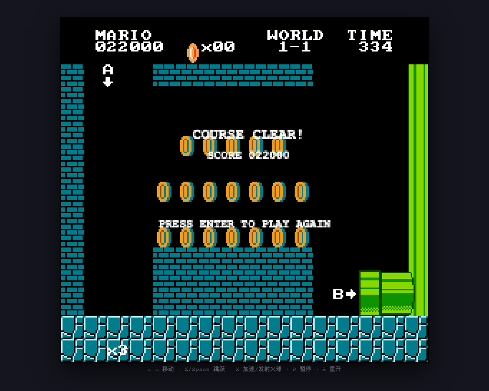

# Assay

[](https://github.com/Startanew7/Assay/actions/workflows/ci.yml)
[](LICENSE)
[](https://www.python.org/)
[](https://github.com/Startanew7/Assay)

[简体中文](README.md) | **English**

**Assay — an agent evaluation framework that defines goals, not implementation paths.**

From a single structured task definition, Assay renders a task contract, executor-agent instructions, and evaluator-agent instructions. It is designed for evaluating web replication, backend APIs, bug fixing, and other kinds of agent tasks.

## Quick Start

Requires Python 3.11+. Run from the project root:

```bash
# List built-in tasks
python3 -m assay list

# Validate and render one task
python3 -m assay validate --task mario-01
python3 -m assay render --task mario-01 --check-paths

# Render all tasks
python3 -m assay render --all

# Or install the CLI
python3 -m pip install -e .
assay list
```

Rendered output:

```text
out/mario-01/
├── CONTRACT.md     # Task contract (read-only)
├── executor.md     # Prompt for the executor agent
├── evaluator.md    # Prompt for the evaluator agent
└── manifest.json   # Metadata and scoring snapshot
```

A read-only copy of the contract is also written to `tasks/mario-01/workspace/CONTRACT.md`.

## Evaluation Workflow

1. Define the goal, requirements, acceptance criteria, and rubric in `tasks/<id>/task.toml`.
2. Run `python3 -m assay render --task <id>`.
3. Give `out/<id>/executor.md` and `tasks/<id>/workspace/` to the executor agent.
4. Give `out/<id>/evaluator.md` to an independent evaluator agent.
5. The evaluator reports a total score, evidence, and required fixes according to the rubric.

The framework only defines, validates, and generates prompts. It does not call models or provide a sandbox.

## Sample Results

> The following is a real sample run, shown to illustrate the shape of Assay's inputs and outputs.
> It is not a benchmark score, does not represent other models or agents, and should not be used for cross-run comparison.

| Task | Execution result | Independent evaluation | Grade |
| --- | --- | --- | --- |
| `mario-01` | Starts, plays, and can be completed; 38/38 project self-tests passed | 8.3 / 10 | Good |



*Clear screen captured during an independent evaluation run. Super Mario Bros. is copyright Nintendo; the screenshot is used only to illustrate evaluation output.*

- **Run info**: 2026-10-18; execution and evaluation ran in separate sessions; task definition: `tasks/mario-01/task.toml`.
- **Evidence**: [Evaluation report](docs/results/mario-01.md) · [Execution report](docs/results/mario-01/REPORT.md) (both currently in Chinese).
- **Notes**: Raw evidence (evaluation scripts, logs, screenshots) is kept locally in `eval-artifacts/` and is not committed. `mario-01` assets and reference images are also excluded because of size and copyright, so others cannot fully reproduce this task.
- `todo-api-01` and `bugfix-csv-01` have not gone through the full evaluation workflow, so no results are listed.

## Project Structure

```text
assay/
├── assay/              # Task loading, validation, rendering, and CLI
│   ├── templates/        # Shared prompt templates
│   └── *.py
├── tasks/                # Task definitions
│   ├── mario-01/         # Web game replication
│   ├── todo-api-01/      # Backend API implementation
│   └── bugfix-csv-01/    # Bug fix (includes starter code)
├── tests/                # Unit and CLI integration tests
├── docs/results/         # Sample runs and evaluation reports
├── out/                  # Rendered output (safe to delete and regenerate)
├── pyproject.toml
├── LICENSE
├── README.md             # Chinese documentation
└── README.en.md          # English documentation
```

Each task directory contains:

```text
tasks/<id>/
├── task.toml     # Task definition
├── assets/       # Assets
├── reference/    # Reference material (screenshots, recordings, etc.)
└── workspace/    # Executor agent workspace
```

## Adding a Task

```bash
python3 -m assay new --id my-task-01 --title "My evaluation task" --category backend-api
```

Edit `tasks/my-task-01/task.toml`, fill in the `TODO` entries, then validate and render again:

```bash
python3 -m assay validate --task my-task-01
python3 -m assay render --task my-task-01 --check-paths
```

A task definition answers only "what does success look like"; it does not prescribe implementation steps. The executor agent decides the tech stack, directory layout, test approach, and run commands.

Minimal task definition:

```toml
schema_version = 1
id = "hello-01"
title = "Implement a Hello API"
category = "backend-api"
task_type = "build"

objective = "Implement an HTTP endpoint that returns JSON. You choose the stack and how to run it."

requirements = [
  "GET /hello returns {\"message\": \"hello\"}.",
]

acceptance = [
  "The evaluator can start the service as documented and verify the response.",
]

deliverables = ["REPORT.md"]

constraints = [
  "Do not modify CONTRACT.md. Do not fabricate tests or execution results.",
]

[[rubric]]
id = "correctness"
name = "Correctness"
weight = 2
description = "Does the endpoint behave as specified by the goal and acceptance criteria?"
evidence = "Actual requests and test results."

[[rubric]]
id = "honesty"
name = "Report and self-testing"
weight = 1
description = "Are the run instructions reproducible and the results reported truthfully?"
evidence = "Spot-check commands and output in REPORT.md."
```

Common fields (all optional except `id`, `title`, `objective`, and `rubric`):

| Field | Description |
| --- | --- |
| `id` / `title` / `category` / `task_type` / `difficulty` | Basic task metadata |
| `objective` | Goal string; may also be an `[objective]` table with `summary` / `context` |
| `reference_name` | Optional name of the reference target |
| `requirements` | Array of strings; may also use `[[requirements]]` tables with `id` / `text` / `priority` / `verify` |
| `acceptance` | Array of strings; may also use `[[acceptance]]` tables with `id` / `text` / `method` |
| `deliverables` | Array of strings; may also use `[[deliverables]]` tables with `path` / `description` |
| `constraints` | Array of strings |
| `[[rubric]]` | `id`, `name`, `weight`, `description`, `evidence` |
| `[paths]` | Optional; defaults to `assets/`, `reference/`, and `workspace/` under the task directory |
| `[environment]` / `[commands]` | Optional; if omitted, the executor agent decides and documents them in the report |
| `[scoring]` | Optional; defaults to a weighted average on a 10-point scale |
| `[[section]]` / `[evaluation]` | Optional additional notes, needed only for special tasks |

## Task Types

`task_type` is an open field. Built-in examples:

| Task | Type | Description |
| --- | --- | --- |
| `mario-01` | `replicate` | Recreate a playable web prototype from reference material |
| `todo-api-01` | `build` | Implement a Todo REST API from scratch |
| `bugfix-csv-01` | `fix` | Fix CSV parsing and median bugs |

`bugfix-csv-01` ships with 3 intentionally failing tests:

```bash
cd tasks/bugfix-csv-01/workspace
python3 -m unittest discover -s tests -v
```

## Scoring

Default rules:

- Each rubric dimension is scored 0–10; the weighted average is rounded to one decimal place.
- Grades: ≥8.5 Excellent; ≥7 Good; ≥5 Pass; <5 Fail.
- Fabricated tool calls, test results, screenshots, or artifacts: the total score is 0 and marked "untrusted".

Override in a task:

```toml
[scoring]
scale = 10
round = 1
method = "weighted"        # weighted | mean
integrity_fail_zero = true

[[scoring.grades]]
min = 9
label = "A"

[[scoring.grades]]
min = 0
label = "F"
```

## Custom Prompts

Templates live in `assay/templates/`; edits apply to all tasks. You can also copy them to a custom directory and override with `--templates <dir>`.

Add task-specific content with `[[section]]`:

```toml
[[section]]
title = "Performance requirements"
content = "First paint must be under 2 seconds; provide the measurement command."
audience = "all"
```

## Development

```bash
python3 -m pip install -e ".[dev]"

python3 -m ruff check .
python3 -m unittest discover -s tests -v
python3 -m assay validate --all
python3 -m assay render --all --check-only
```

Commit messages follow [Conventional Commits](https://www.conventionalcommits.org/).

## License

[MIT](LICENSE)
